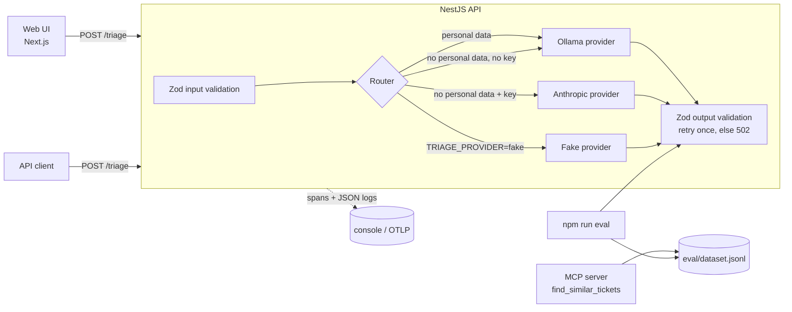

# ticket-triage

[](https://github.com/sppant/ticket-triage/actions/workflows/ci.yml)

A support-ticket triage service. `POST /triage` takes a ticket and returns a category, a priority and a draft reply. A router sends tickets that contain personal data (email, phone, card-like number) to a free local open-weight model via Ollama, and everything else to a hosted Claude model when `ANTHROPIC_API_KEY` is set (otherwise to the local model). Model output is validated with Zod, retried once, then fails with a 502. The repo also has a Next.js UI, an evaluation harness, OpenTelemetry tracing with structured logs, and a read-only MCP server. Everything runs on a laptop; nothing is deployed.

|                                          |                                        |
| ---------------------------------------- | -------------------------------------- |
|  |  |

_Screenshots are of the running app talking to the local `qwen2.5:1.5b` model, on the "Locked out" example (it contains personal data, so it is routed locally)._

## Quick start

Requires Node 22 (`nvm use`) and [Ollama](https://ollama.com/download).

```bash
# 1. local model (any small instruct model works; this is the default)
ollama pull qwen2.5:1.5b

# 2. API on :3001
npm ci
cp .env.example .env        # optional; defaults work with a local Ollama
npm run build && npm start

# 3. web UI on :3000 (second terminal)
npm ci --prefix web
npm run dev --prefix web
```

Set `ANTHROPIC_API_KEY` in `.env` to route non-personal tickets to the hosted model (`ANTHROPIC_MODEL`, default `claude-haiku-5-5`). Set `TRIAGE_PROVIDER=fake` to use the deterministic fake provider with no model at all. Every variable is documented in [`.env.example`](.env.example).

## API

```bash
curl -s localhost:3001/triage -H 'content-type: application/json' -d '{
  "subject": "Charged twice this month",
  "body": "I was billed twice for my subscription. Please refund one payment. Reach me at jane@example.com"
}'
```

```json
{
  "category": "billing",
  "priority": "high",
  "draft_reply": "…",
  "model": "qwen2.5:1.5b",
  "latency_ms": 1320,
  "provider": "ollama",
  "route_reason": "local model: ticket contains personal data"
}
```

`provider` and `route_reason` are additions to the original response shape so the UI can show why a model was chosen. Invalid input returns 400; invalid model output after one retry, or a provider failure, returns 502. OpenAPI: Swagger UI at `/docs`, JSON at `/docs-json`.

## How the router decides

1. `TRIAGE_PROVIDER=fake` → fake provider (tests, CI, demos).
2. Ticket (subject + body) contains personal data → **local model**, always. If the local model fails the request fails with 502; it is never retried on the hosted model.
3. Otherwise, `ANTHROPIC_API_KEY` set → **hosted model**.
4. Otherwise → **local model**.

Personal data is detected by a small, tested heuristic (`src/pii/pii.ts`): email addresses, phone numbers (`(555) 123-4567`, `555-123-4567`, international `+…` numbers) and card-like numbers (13–19 digits). It favours simplicity: it can miss exotic formats and can flag look-alikes.



## Evaluation

`npm run eval` runs every available provider over the 40 synthetic tickets in [`eval/dataset.jsonl`](eval/dataset.jsonl) through the same pipeline the API uses (prompt, JSON validation, one retry) and writes `eval/results.md`. A provider that is not available (no Ollama model, no API key) is reported as skipped and gets no numbers. The fake provider is excluded unless `EVAL_INCLUDE_FAKE=1`.

Results, run on a laptop (macOS 14, Ollama 0.40.18, sequential requests, wall-clock latency including any retry):

| Provider  | Model                       | Category acc. | Priority acc. | Errors | Avg latency | Est. cost / 1,000 tickets |
| --------- | --------------------------- | ------------- | ------------- | ------ | ----------- | ------------------------- |
| ollama    | llama3.2:1b (first prompt)  | 52.5%         | 55.0%         | 0      | 1563 ms     | $0 (local)                |
| ollama    | qwen2.5:1.5b (first prompt) | 92.5%         | 50.0%         | 0      | 1579 ms     | $0 (local)                |
| ollama    | qwen2.5:1.5b (**current**)  | 90.0%         | 57.5%         | 0      | 1323 ms     | $0 (local)                |
| anthropic | claude-haiku-5-5            | **not run**   | **not run**   | –      | –           | **not run**               |

The hosted model was **not evaluated**: no `ANTHROPIC_API_KEY` was available when this was written, so there are no accuracy, latency or cost numbers for it, and I have not estimated them. The cost column is computed from measured token counts and the prices in `.env.example` (`EVAL_ANTHROPIC_*_PER_MTOK`) once a key is set.

The "current" row uses a system prompt that gained a short priority guide (high = blocked / outage / data loss / money wrongly taken, low = general question, medium = the rest) after the first `qwen2.5:1.5b` run showed weak priority accuracy. That is one round of prompt tuning against this same 40-ticket set, so treat the improvement as indicative, not as a held-out result. With 40 tickets, one ticket is 2.5 points; differences of a few points are noise.

**Which model would I choose?** Of the two local models I measured, `qwen2.5:1.5b`: at about the same latency it classifies category far better than `llama3.2:1b` (90% vs 52.5%). For tickets with personal data the local model is the only option by design, so that is what they get. Priority is the weak spot, at 57.5% for the best local run, so I would use the model's priority as a suggestion for a human to confirm, not to act on automatically. I cannot say whether the hosted model is worth its cost for non-personal tickets, because I did not run it; the right next step is `ANTHROPIC_API_KEY=… npm run eval` and a comparison on these same columns, especially priority accuracy.

Reproduce:

```bash
ollama pull qwen2.5:1.5b
npm ci
npm run eval                                    # local model
ANTHROPIC_API_KEY=sk-ant-... npm run eval       # also the hosted model
OLLAMA_MODEL=llama3.2:1b npm run eval           # another local model (pull it first)
```

## Observability

Each request produces a `triage.request` span with a child `model.call` span carrying `llm.provider`, `llm.model`, `llm.latency_ms` and, when the provider reports them, `llm.input_tokens` / `llm.output_tokens`. Spans go to the console by default and to OTLP/HTTP when `OTEL_EXPORTER_OTLP_ENDPOINT` is set. Logs are JSON (pino). Ticket content is never logged or put on spans; a test asserts this with a sentinel string.

## MCP server

A read-only stdio MCP server in [`mcp/`](mcp/README.md) with one tool, `find_similar_tickets(query)`, which keyword-searches the eval dataset and returns the top 3 tickets.

```json
{
  "mcpServers": {
    "ticket-triage": {
      "command": "/absolute/path/to/ticket-triage/node_modules/.bin/tsx",
      "args": ["/absolute/path/to/ticket-triage/mcp/server.ts"]
    }
  }
}
```

Or with Claude Code: `claude mcp add ticket-triage -- /absolute/path/to/ticket-triage/node_modules/.bin/tsx /absolute/path/to/ticket-triage/mcp/server.ts` (run `npm ci` first).

## Project layout

```
specs/          actors, use cases, features, acceptance criteria (tests cite AC-ids)
src/            NestJS API: triage/, router/, pii/, providers/, observability/
test/           e2e test of POST /triage with the fake provider
eval/           dataset.jsonl, runner, metrics, report
mcp/            MCP server and its README
web/            Next.js UI, Storybook stories, Playwright test
docs/           how-it-was-built.md, screenshots
```

## Tests

```bash
npm run lint && npm run typecheck && npm test      # API, eval, MCP (110 tests, no network or model needed)
npm run test:cov                                   # coverage
cd web && npm ci && npm run lint && npm run typecheck && npm run build
cd web && npx playwright install chromium && npm run test:e2e   # starts the API with the fake provider and the web app
cd web && npm run storybook                        # component stories
```

CI (`.github/workflows/ci.yml`) runs install, lint, typecheck, test and build for the API, and install, lint, typecheck and build for the web app. The Playwright test is not part of CI.

## More

- [`specs/`](specs/) — the requirements the code and tests are written against.
- [`docs/how-it-was-built.md`](docs/how-it-was-built.md) — how the work was split and reviewed.
- [`CONTRIBUTING.md`](CONTRIBUTING.md), [MIT license](LICENSE).
