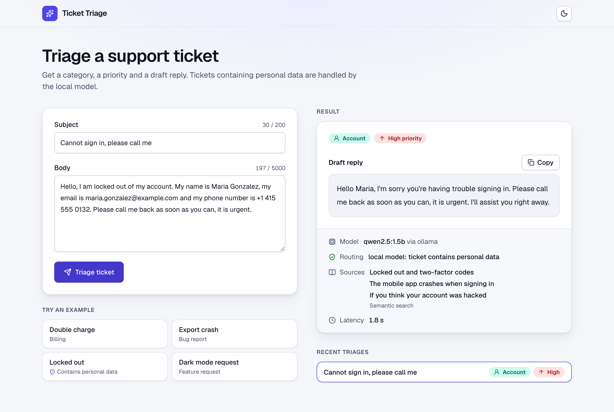
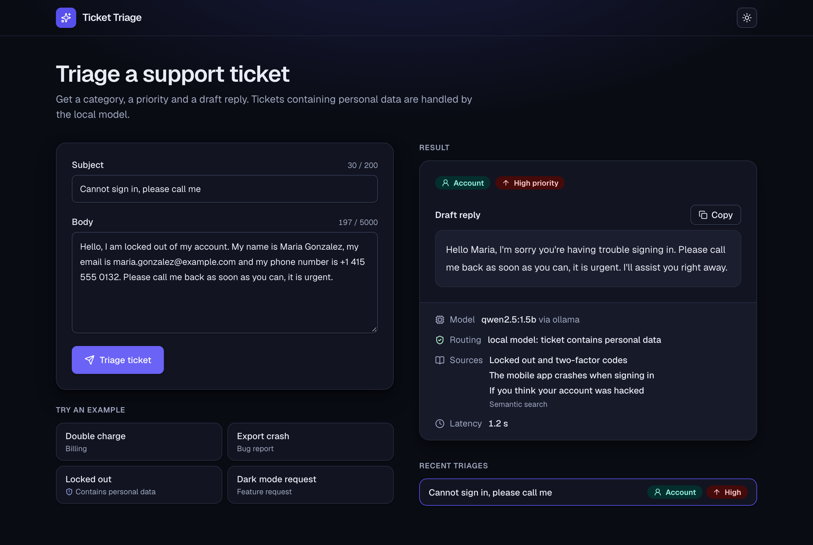
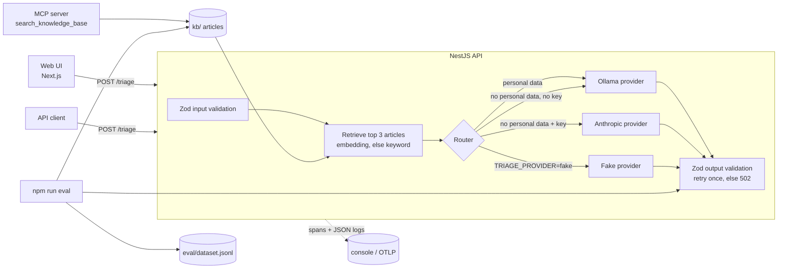
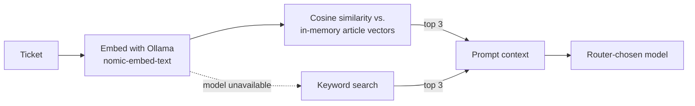

# ticket-triage

[](https://github.com/sppant/ticket-triage/actions/workflows/ci.yml)

A support-ticket triage service. `POST /triage` takes a ticket and returns a category, a priority and a draft reply grounded in the three most relevant help-center articles (retrieval-augmented generation with a local embedding model and no vector database). A router sends tickets that contain personal data (email, phone, card-like number) to a free local open-weight model via Ollama, and everything else to a hosted Claude model when `ANTHROPIC_API_KEY` is set (otherwise to the local model). Model output is validated with Zod, retried once, then fails with a 502. The repo also has a Next.js UI, an evaluation harness (including retrieval hit rate), OpenTelemetry tracing with structured logs, and a read-only MCP server that searches the knowledge base. Everything runs on a laptop; nothing is deployed.

|                                          |                                        |
| ---------------------------------------- | -------------------------------------- |
|  |  |

_Screenshots are of the running app talking to the local `qwen2.5:1.5b` model, on the "Locked out" example (it contains personal data, so it is routed locally). Sources are the retrieved help-center articles._

## Quick start

Requires Node 22 (`nvm use`) and [Ollama](https://ollama.com/download).

```bash
# 1. local models: a small instruct model and the embedding model for retrieval
ollama pull qwen2.5:1.5b
ollama pull nomic-embed-text

# 2. API on :3001
npm ci
cp .env.example .env        # optional; defaults work with a local Ollama
npm run build && npm start

# 3. web UI on :3000 (second terminal)
npm ci --prefix web
npm run dev --prefix web
```

Set `ANTHROPIC_API_KEY` in `.env` to route non-personal tickets to the hosted model (`ANTHROPIC_MODEL`, default `claude-haiku-5-5`). Set `TRIAGE_PROVIDER=fake` to use the deterministic fake provider with no model at all. Every variable is documented in [`.env.example`](.env.example).

## API

```bash
curl -s localhost:3001/triage -H 'content-type: application/json' -d '{
  "subject": "Charged twice this month",
  "body": "I was billed twice for my subscription. Please refund one payment. Reach me at jane@example.com"
}'
```

```json
{
  "category": "billing",
  "priority": "high",
  "draft_reply": "…",
  "model": "qwen2.5:1.5b",
  "latency_ms": 2824,
  "provider": "ollama",
  "route_reason": "local model: ticket contains personal data",
  "sources": [
    "Duplicate charges and failed payments",
    "Charges you do not recognise",
    "Duplicate email notifications"
  ],
  "retrieval": "embedding"
}
```

`provider` and `route_reason` let the UI show why a model was chosen; `sources` are the titles of the retrieved articles that were given to the model, and `retrieval` is `embedding` or `keyword` (see below). Invalid input returns 400; invalid model output after one retry, or a provider failure, returns 502. OpenAPI: Swagger UI at `/docs`, JSON at `/docs-json`.

## How the router decides

1. `TRIAGE_PROVIDER=fake` → fake provider (tests, CI, demos).
2. Ticket (subject + body) contains personal data → **local model**, always. If the local model fails the request fails with 502; it is never retried on the hosted model.
3. Otherwise, `ANTHROPIC_API_KEY` set → **hosted model**.
4. Otherwise → **local model**.

Personal data is detected by a small, tested heuristic (`src/pii/pii.ts`): email addresses, phone numbers (`(555) 123-4567`, `555-123-4567`, international `+…` numbers) and card-like numbers (13–19 digits). It favours simplicity: it can miss exotic formats and can flag look-alikes.



## Retrieval (RAG)

The knowledge base is the 20 short synthetic help-center articles in [`kb/`](kb/) (billing, bugs, account, features and a few general topics; no real data).

- **Startup:** the API embeds every article with a local Ollama embedding model (`EMBEDDING_MODEL`, default `nomic-embed-text`) and keeps the vectors in memory. There is no vector database and nothing is written to disk.
- **Per ticket:** subject and body are embedded by the same local model, the three articles with the highest cosine similarity are retrieved, and their titles and text are put in the prompt before the ticket. The response lists their titles as `sources` with `retrieval: "embedding"`. Ticket text is only ever embedded by the local model, including for tickets without personal data, and is not logged.
- **Fallback:** if the embedding model is unavailable (not pulled, Ollama down, or a request times out) the service uses keyword search instead: a word-overlap score over title and text, whole words only, stop-words ignored. The response then says `retrieval: "keyword"` and the request still succeeds. If the index could not be built at startup, a later request tries again. With `TRIAGE_PROVIDER=fake` retrieval is keyword-only, so tests and CI need no model.
- The same retrieval backs the MCP tool `search_knowledge_base`.



## Evaluation

`npm run eval` runs every available provider over the 40 synthetic tickets in [`eval/dataset.jsonl`](eval/dataset.jsonl) through the same pipeline the API uses (retrieval, prompt, JSON validation, one retry) and writes `eval/results.md`. Each ticket also records the knowledge-base article that should be retrieved, and the eval reports the top-3 retrieval hit rate for each retrieval mode that can run. A provider or mode that is not available (no Ollama model, no embedding model, no API key) is reported as skipped and gets no numbers. The fake provider is excluded unless `EVAL_INCLUDE_FAKE=1`.

Measured on a laptop (macOS 14, Ollama 0.40.18, sequential requests, wall-clock latency including retrieval and any retry). One ticket is 2.5 points, so differences of a few points are noise.

**Triage accuracy**

| Model                                                            | Retrieval      | Category acc. | Priority acc. | Errors | Avg latency | Est. cost / 1,000 tickets |
| ---------------------------------------------------------------- | -------------- | ------------- | ------------- | ------ | ----------- | ------------------------- |
| llama3.2:1b, first prompt                                        | none (pre-RAG) | 52.5%         | 55.0%         | 0      | 1563 ms     | $0 (local)                |
| qwen2.5:1.5b, first prompt                                       | none (pre-RAG) | 92.5%         | 50.0%         | 0      | 1579 ms     | $0 (local)                |
| qwen2.5:1.5b, + priority guide                                   | none (pre-RAG) | 90.0%         | 57.5%         | 0      | 1323 ms     | $0 (local)                |
| qwen2.5:1.5b, current prompt, no articles (`KB_DIR` = empty dir) | none           | 87.5%         | 55.0%         | 0      | 1237 ms     | $0 (local)                |
| **qwen2.5:1.5b, current prompt (shipped)**                       | **embedding**  | **75.0%**     | **57.5%**     | 0      | 2115 ms     | $0 (local)                |
| claude-haiku-5-5                                                 | –              | **not run**   | **not run**   | –      | –           | **not run**               |

**Retrieval** (is the expected article among the 3 retrieved? embedding index built with `nomic-embed-text`)

| Mode      | Top-3 hit rate | Hits  | Avg retrieval latency |
| --------- | -------------- | ----- | --------------------- |
| embedding | 100.0%         | 40/40 | 20 ms                 |
| keyword   | 97.5%          | 39/40 | < 1 ms                |

What these numbers do and do not say:

- **The retrieval hit rates are optimistic.** The articles, the tickets and the expected-article labels were all written by the same author with the dataset in view, so each article mirrors the wording of the tickets it answers. Treat 100% as a check that the pipeline works, not as evidence it would generalise to real tickets; keyword search being almost as good says the test is easy.
- **Retrieval made category accuracy worse for this small model.** With the same prompt, giving `qwen2.5:1.5b` three articles dropped category accuracy from 87.5% to 75.0% (5 tickets) and added about 0.9 s per ticket; priority moved from 55.0% to 57.5%, which is within noise. A first version of the prompt scored 70.0% / 65.0%; I then added "choose category and priority from the ticket alone" and re-ran, which gave the shipped 75.0% / 57.5%. That is two rounds of prompt tuning on the same 40 tickets. I did not try other mitigations (for example classifying in a separate call without articles, or a larger model).
- **Reply quality is not measured.** The eval has no metric for whether draft replies use the articles well; the retrieval hit rate only shows that the right article reached the prompt. In the two replies I read while building this, one used article content (the double-charge reply asked for the last four digits of the card and the charge dates) and one did not (the locked-out reply in the screenshot).
- The "current prompt, no articles" row is reproducible with `KB_DIR=$(mktemp -d) npm run eval`.
- The hosted model was **not evaluated**: no `ANTHROPIC_API_KEY` was available, so there are no accuracy, latency or cost numbers for it and I have not estimated them. The cost column is computed from measured token counts and the prices in `.env.example` once a key is set.

**Which model would I choose?** Locally, `qwen2.5:1.5b` over `llama3.2:1b` (category 87–92% vs 52.5% before retrieval was added, at similar latency). Personal-data tickets can only use the local model by design. For this small model I would not claim retrieval helps the labels: it hurt category accuracy here, so I would treat category and priority as suggestions for a human to confirm, and judge retrieval by reply quality, which I have not measured. Whether the hosted model is worth its cost for non-personal tickets I cannot say, because I did not run it; the next step is `ANTHROPIC_API_KEY=… npm run eval` and a comparison on these same columns.

Reproduce:

```bash
ollama pull qwen2.5:1.5b
ollama pull nomic-embed-text   # without it only keyword retrieval is evaluated
npm ci
npm run eval                                    # local model
ANTHROPIC_API_KEY=sk-ant-... npm run eval       # also the hosted model
OLLAMA_MODEL=llama3.2:1b npm run eval           # another local model (pull it first)
```

## Observability

Each request produces a `triage.request` span with a child `model.call` span carrying `llm.provider`, `llm.model`, `llm.latency_ms` and, when the provider reports them, `llm.input_tokens` / `llm.output_tokens`. Spans go to the console by default and to OTLP/HTTP when `OTEL_EXPORTER_OTLP_ENDPOINT` is set. Logs are JSON (pino). Ticket content is never logged or put on spans; a test asserts this with a sentinel string.

## MCP server

A read-only stdio MCP server in [`mcp/`](mcp/README.md) with one tool, `search_knowledge_base(query)`, which uses the same retrieval as the API (embeddings from local Ollama, keyword fallback) and returns the top 3 help-center articles and the retrieval mode.

```json
{
  "mcpServers": {
    "ticket-triage": {
      "command": "/absolute/path/to/ticket-triage/node_modules/.bin/tsx",
      "args": ["/absolute/path/to/ticket-triage/mcp/server.ts"]
    }
  }
}
```

Or with Claude Code: `claude mcp add ticket-triage -- /absolute/path/to/ticket-triage/node_modules/.bin/tsx /absolute/path/to/ticket-triage/mcp/server.ts` (run `npm ci` first).

## Project layout

```
specs/          actors, use cases, features, acceptance criteria (tests cite AC-ids)
src/            NestJS API: triage/, router/, pii/, providers/, retrieval/, observability/
test/           e2e test of POST /triage with the fake provider
kb/             help-center articles (Markdown) used for retrieval
eval/           dataset.jsonl (with expected article), runner, metrics, report
mcp/            MCP server and its README
web/            Next.js UI, Storybook stories, Playwright test
docs/           how-it-was-built.md, screenshots
```

## Tests

```bash
npm run lint && npm run typecheck && npm test      # API, eval, MCP (131 tests, no network or model needed)
npm run test:cov                                   # coverage
cd web && npm ci && npm run lint && npm run typecheck && npm run build
cd web && npx playwright install chromium && npm run test:e2e   # starts the API with the fake provider and the web app
cd web && npm run storybook                        # component stories
```

CI (`.github/workflows/ci.yml`) runs install, lint, typecheck, test and build for the API, and install, lint, typecheck and build for the web app. The Playwright test is not part of CI.

## More

- [`specs/`](specs/) — the requirements the code and tests are written against.
- [`docs/how-it-was-built.md`](docs/how-it-was-built.md) — how the work was split and reviewed.
- [`CONTRIBUTING.md`](CONTRIBUTING.md), [MIT license](LICENSE).
